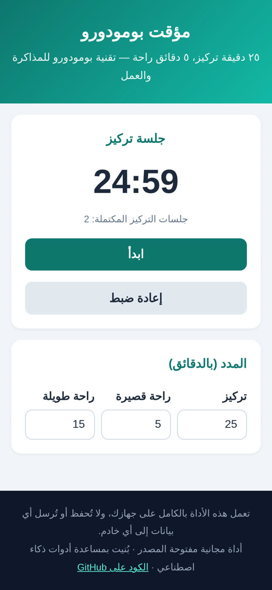

# Pomodoro Timer | مؤقت بومودورو

A simple Pomodoro timer: 25 minutes of focus and 5-minute breaks, with a session counter and a long break every four sessions. Arabic interface.

**Live app:** https://abood-ayman.github.io/pomodoro-timer-ar/

**LinkedIn:** [Project entry](https://www.linkedin.com/in/abdullah-ayman-1678b737b/details/projects/)

This is a personal project, built with AI tools.

## Features
- 25-minute focus sessions and 5-minute short breaks
- Automatic 15-minute long break after every 4 focus sessions
- Completed-session counter, start/pause/reset
- Simple sound alert at the end of each session

## Privacy
Everything runs in your browser. No data is stored or sent anywhere.

## Run locally
Open `index.html` in any browser. It is a single static page with no dependencies.

## Status
Stable.

## Copyright
MIT License - Copyright (c) 2026 Abdullah Ayman.
